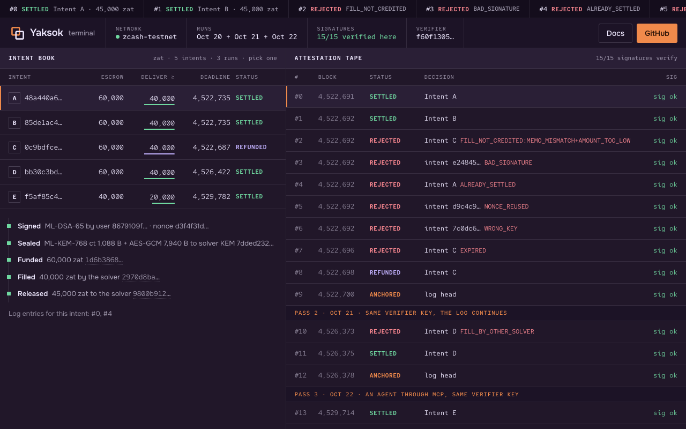

# Yaksok — post-quantum intents, settled in shielded ZEC

Post-quantum intents for agents, settled in shielded ZEC: an order is signed with ML-DSA-65 and
sealed with ML-KEM-768, a solver delivers from its own liquidity, and every decision is a signed,
hash-chained, memo-anchored log entry anyone can re-verify. A private OTC delivery desk on Zcash
testnet, run live three times, the third by an agent through MCP.

**Live demo:** not hosted yet. The repo is not public; once it is, `pnpm build:site` produces one
static folder (`site/`: the landing, with the terminal at `terminal/`) for GitHub Pages. Until then
the 60-second command below shows the same terminal locally.
**Video:** none current. The only clip (`zec-pq-intents-demo.mp4`, 26 s, Oct 20) re-verifies the
first run in a terminal and predates this UI and passes 2 and 3.



## What is live (Zcash testnet)

| Run | What happened | Key transaction |
|---|---|---|
| Pass 1, Oct 20 (`deployments/testnet.json`) | intents A–C funded in one shielded tx; A and B filled and settled; six attacks refused with signed entries; C refunded; the log head anchored in a memo | anchor [`a7d96038…`](https://testnet.zecblock.com/tx/a7d960386f2d8dc926003e700b15bcc761b6e72419765ea6f958a85d73a65a73) |
| Pass 2, Oct 21 (`testnet-pass2.json`) | intent D; a second solver's claim refused; the verifier killed (SIGKILL) right after the release broadcast, reconciled on restart, paid once; an anchor naming pass 1's | release [`c0557316…`](https://testnet.zecblock.com/tx/c0557316e0378e65a3d63b2996a139b88dff37f8bfe2e1ce5f3af32e8fca0db1) |
| Pass 3, Oct 22 (`testnet-pass3.json`) | an agent calls MCP `quote` and `submit_intent` (intent E, its own key, a new receive address); the desk is killed right after the fill broadcast and the restart finds the fill instead of resending it; E settles; an anchor naming pass 2's; `verify_log` and `check-anchors` pass | release [`6b63f403…`](https://testnet.zecblock.com/tx/6b63f403ceaf79c436edb8a9457133c97ad9ff1998a5f3254b57dd469876599a) |

**Tampered, replayed, expired or wrong-key intents get a signed refusal, never a payout** (entries
of the published log, each ML-DSA-65 signed and re-verified in your browser):

- tampered (A's `min_out` changed after signing) → `BAD_SIGNATURE`, log #3
- replayed (A again after it settled) → `ALREADY_SETTLED`, log #4; A's nonce in a new intent → `NONCE_REUSED`, log #5
- expired (a correct fill of C mined after its deadline) → `EXPIRED`, log #7
- wrong key (signed by another ML-DSA key but naming the user) → `WRONG_KEY`, log #6
- a fill with the wrong memo → `FILL_NOT_CREDITED`, log #2; a claim by a solver the fill does not name → `FILL_BY_OTHER_SOLVER`, log #10

**See it in 60 seconds** (Node 22+ and pnpm 10; nothing to build first):

```sh
pnpm install && pnpm --filter @pqi/dashboard dev     # the Yaksok terminal on http://localhost:5181
```

The terminal re-verifies every ML-DSA-65 signature of all three testnet runs (15 entries) in your
browser, recomputes every anchored head, and lets you tamper with an intent and watch it fail.

## What it is

**Post-quantum intents, settled in shielded ZEC.** An intent is signed with **ML-DSA-65** (FIPS 204)
and sealed to the solver with **ML-KEM-768** (FIPS 203). The user escrows real testnet ZEC, the
solver delivers from its own liquidity to the user's receive address, and a verifier releases the
escrow or refunds it, writing every decision as an ML-DSA-signed, hash-chained log entry whose head
is anchored in a shielded memo. Anyone can re-verify all of it.

Zcash spends stay elliptic-curve based: this is post-quantum **at the intent layer**, using the NIST
primitives Zcash's roadmap introduces later (ML-KEM with Tachyon). Not trustless: the verifier holds
the escrow (see [docs](packages/docs/README.md)).

## Every log entry, run by run

Pass 1, Oct 20, 2026 (`deployments/testnet.json`). Demo-only wallets; their incoming viewing keys
and the signed intents are published so every decision can be re-checked. Verifier key
`f60f130579…` (ML-DSA-65), solver KEM key `7dded232ab…` (ML-KEM-768).

Three intents (escrow 60,000 zat → deliver 40,000 zat, a 20,000 zat solver spread; a release or a
refund pays 60,000 − 15,000 fee budget = 45,000 zat, so the solver nets 5,000 over what it delivered,
a refunded user gets 45,000 back and loses 15,000, and whatever the payout transaction does not spend
of the budget stays in the escrow wallet, which the verifier holds), funded together in one shielded transaction:
**A** (`48a440a6…`) and **B** (`85de1ac4…`) were filled and settled; **C** (`0c9bdfce…`, 12-block
deadline) was attacked twice and refunded.

| # | Entry | Reason | Transactions |
|---|---|---|---|
| 0 | SETTLED | — | funding [`1d6b3868…`](https://testnet.zecblock.com/tx/1d6b38683c64a5e157af4cbfed344dca3604c28242f178de83894654b68354d9), fill [`2970d8ba…`](https://testnet.zecblock.com/tx/2970d8ba4538bdfae599a64d016c65231e42addb544ccdc1a609f17df59448cb), release [`9800b912…`](https://testnet.zecblock.com/tx/9800b912682a0630a64dd4a54c245fc7c0810ee117eed7b304138fddda63b7c2) |
| 1 | SETTLED | — | funding [`1d6b3868…`](https://testnet.zecblock.com/tx/1d6b38683c64a5e157af4cbfed344dca3604c28242f178de83894654b68354d9), fill [`a74b9dfe…`](https://testnet.zecblock.com/tx/a74b9dfe4a74304078f77b80eb27c7a2653f263562874dc14bb6a6a072307dd1), release [`6b34215c…`](https://testnet.zecblock.com/tx/6b34215c46c7aff1e2924a8f8608b0cc17f376f254e10c4f027ad766111718d9) |
| 2 | REJECTED | FILL_NOT_CREDITED:MEMO_MISMATCH+AMOUNT_TOO_LOW | fill [`36d0f49a…`](https://testnet.zecblock.com/tx/36d0f49acbcb0498073393f554c135697cb5c0bccc6ce788deb6b3c3a05bc33a) |
| 3 | REJECTED | BAD_SIGNATURE | funding [`1d6b3868…`](https://testnet.zecblock.com/tx/1d6b38683c64a5e157af4cbfed344dca3604c28242f178de83894654b68354d9) |
| 4 | REJECTED | ALREADY_SETTLED | funding [`1d6b3868…`](https://testnet.zecblock.com/tx/1d6b38683c64a5e157af4cbfed344dca3604c28242f178de83894654b68354d9) |
| 5 | REJECTED | NONCE_REUSED | funding [`1d6b3868…`](https://testnet.zecblock.com/tx/1d6b38683c64a5e157af4cbfed344dca3604c28242f178de83894654b68354d9) |
| 6 | REJECTED | WRONG_KEY | funding [`1d6b3868…`](https://testnet.zecblock.com/tx/1d6b38683c64a5e157af4cbfed344dca3604c28242f178de83894654b68354d9) |
| 7 | REJECTED | EXPIRED | fill [`3b81e337…`](https://testnet.zecblock.com/tx/3b81e337b0669f97ad0f8c4a02a0e332a412a65276fbb5db0088704c6c39b1bb) |
| 8 | REFUNDED | — | funding [`1d6b3868…`](https://testnet.zecblock.com/tx/1d6b38683c64a5e157af4cbfed344dca3604c28242f178de83894654b68354d9), refund [`357b7065…`](https://testnet.zecblock.com/tx/357b706505ae07232939aa39fe7a862363283b49a06e4a62fafc6eaa823a2966) |
| 9 | ANCHORED | — | anchor [`a7d96038…`](https://testnet.zecblock.com/tx/a7d960386f2d8dc926003e700b15bcc761b6e72419765ea6f958a85d73a65a73) |

### Pass 2 (Oct 21): the fixes, live

Same verifier key and wallets; the log continues to entry 12 (`deployments/testnet-pass2.json`).
Intent **D** (`bb30c3bd…`): funding [`be265ece…`](https://testnet.zecblock.com/tx/be265ece5755724760caa319051ef4002ad6e8991254099b5394f96549bdaa40) (the desk waited for 3 confirmations), fill
[`7f220bd5…`](https://testnet.zecblock.com/tx/7f220bd59aea6486977f5a467519c033430cf73f87b040fd29ad44281953d619) with memo `pqi1:<D>:fill:<solver key id>`, release [`c0557316…`](https://testnet.zecblock.com/tx/c0557316e0378e65a3d63b2996a139b88dff37f8bfe2e1ce5f3af32e8fca0db1), anchor [`694a94c7…`](https://testnet.zecblock.com/tx/694a94c7f81b83f396ca3f974f08eb7c43cc801663c442ff225a07a429a9b41c).

| # | Entry | What happened |
|---|---|---|
| 10 | REJECTED `FILL_BY_OTHER_SOLVER` | a second configured solver signed a claim on D's fill; the memo names the first |
| 11 | SETTLED | the desk ran in a child process that was killed (SIGKILL) right after broadcasting the release, before saving its txid. The restarted verifier found `pqi1:<D>:release` in the escrow's history, waited while it was in the mempool, and settled with that txid. The escrow sent it once. |
| 12 | ANCHORED | memo `pqi1:anchor:11:<head>:a7d96038…` names the Oct 20 anchor; `check-anchors` lists both from the escrow's history as one chain |

What the rejections were: #2 the solver "filled" C with the wrong memo; #3 A with `min_out` changed
to 1 after signing; #4 A again after it settled; #5 a new intent reusing A's nonce; #6 an intent
signed by another ML-DSA key but naming the user; #7 a correct fill of C mined after its deadline.
The anchor memo `pqi1:anchor:8:<head>` was found on-chain with the anchor's viewing key and equals
the recomputed head of entries 0–8. Every payout was re-read with the recipient's viewing key.

### Pass 3 (Oct 22): an agent trades through MCP, live

Same verifier key and escrow; the log continues to entry 14 (`deployments/testnet-pass3.json`,
`pnpm --filter @pqi/mcp pass3`). An MCP client called `quote` (accept, 20,000 zat spread) and
`submit_intent`, which signed intent **E** (`f5af85c4…`) with the agent's own ML-DSA-65 key, sent it
to a new receive address of the agent's receive key, saved it, funded the escrow
[`3ba64090…`](https://testnet.zecblock.com/tx/3ba6409028ebb04a0331be9b9564245b4553aa9b847dec1ce21eb0532a1d3ac1) (40,000 zat) and posted the
sealed envelope to a live desk over HTTP. The desk was killed with SIGKILL right after the solver
broadcast the fill [`0ef36c7f…`](https://testnet.zecblock.com/tx/0ef36c7f68e08f1a825d5985df6b9a7efbf89f906f3e2d5f72a98caa97364b0a) (20,000 zat,
memo naming the solver key), with its write-ahead record on disk and no txid saved. On restart it
found the fill memo in the solver's history and adopted that txid; the solver's history shows the
fill memo once, so nothing was sent twice.

| # | Entry | What happened |
|---|---|---|
| 13 | SETTLED | E released [`6b63f403…`](https://testnet.zecblock.com/tx/6b63f403ceaf79c436edb8a9457133c97ad9ff1998a5f3254b57dd469876599a) (25,000 zat = 40,000 − 15,000 fee budget) |
| 14 | ANCHORED | anchor [`7b1ce3f2…`](https://testnet.zecblock.com/tx/7b1ce3f29e9fc14239fab38fba9d0286b2dab327f465d43f959c3d22f9766f4f) of the head through #13, naming pass 2's anchor `694a94c7…` |

Then `verify_log` over MCP returned ok for all 15 entries and 3 anchors, and `check-anchors` with
the escrow pinned exited 0 with the three anchors in one chain (#8 → #11 → #13).

## Packages

| Package | What |
|---|---|
| [`packages/protocol`](packages/protocol) | canonical intents, ML-DSA-65 signatures, ML-KEM-768 + AES-256-GCM envelopes, fill attestations, signed hash-chained log (browser-safe) |
| [`packages/node`](packages/node) | verifier (escrow, checks, payouts, log), solver (open, quote, deliver, claim), desk (board + state machine + HTTP), live/published server |
| [`packages/scan`](packages/scan) | `zpay-verify` (copy): viewing-key checks of every funding, fill, payout and anchor; `tip` |
| [`packages/mcp`](packages/mcp) | `pqi-mcp`: `quote`, `submit_intent`, `resubmit`, `status`, `verify_log`; `pnpm --filter @pqi/mcp pass3` is the pass-3 run |
| [`packages/examples`](packages/examples) | the resumable live runs of pass 1 and 2 (`run-live`, `pass2`) |
| [`packages/dashboard`](packages/dashboard) | the Yaksok terminal: intent book, attestation tape re-verified in the browser, inspector, anchor, attack console |
| [`packages/docs`](packages/docs) | protocol, rejections, trust model, roadmap sources |
| [`packages/landing`](packages/landing) | one-page landing generated from the run record; its tape re-verifies in the browser too |

## Run it

The 60-second path is at the top. **Everything else** needs Rust 1.89 (pinned in `packages/scan`) for the `zpay-verify` viewing-key
checker, and **zingo-cli** for the wallet calls (`check-anchors`, the live desk, and the node tests
that read the escrow's history or a wallet balance). Build zingo-cli from
[zingolib](https://github.com/zingolabs/zingolib) at commit `0a5cb69ab` (the commit the runs used):

```sh
git clone https://github.com/zingolabs/zingolib ~/src/zingolib && git -C ~/src/zingolib checkout 0a5cb69ab
(cd ~/src/zingolib && cargo build --release -p zingo-cli)
export PQI_ZINGO_CLI=~/src/zingolib/target/release/zingo-cli   # this is also the default path
```

Without it, those commands stop with `Setup required: PQI_ZINGO_CLI`. Then:

```sh
pnpm test                                    # every package (TESTING.md); node and mcp read Zcash testnet
pnpm test:e2e                                # Google Chrome E2E: landing, terminal, desks (TESTING.md)
node packages/landing/build.mjs              # regenerate the landing from deployments/*.json
PQI_PUBLISHED=deployments/testnet.json pnpm --filter @pqi/node serve    # read-only desk on 127.0.0.1:8404
PQI_VERIFIER_ID=f60f130579386479043287fb68c2c1726a0a210be77aee46b355adb1287f1445 \
PQI_ESCROW_UA=utest1fgwtrf8nq6e2j6w7rwa06k8ggmc5llsk3v7mjjnpy5ywmdfrjzuqfvlm4wpeggn9lq7cutkum7k75v8zqg2rxlg3z0k67lcz3cmcs558 \
  pnpm --filter @pqi/node check-anchors "$PWD/deployments/testnet-pass3.json"  # every anchor the escrow sent, one chain, none past the log's end
PQI_FUNDER_WALLET=<demo wallet> pnpm --filter @pqi/examples run-live    # a new live run
```

MCP server: `node packages/mcp/dist/main.js` (after `pnpm build`) with
`PQI_VERIFIER_ID=f60f130579386479043287fb68c2c1726a0a210be77aee46b355adb1287f1445`; see
[`packages/mcp`](packages/mcp) for the other pins.

## Honest limits

- The verifier holds the escrow and is trusted for liveness (it could withhold a payout); it cannot
  fake the record without the signatures, links or anchors showing it.
- The solver and the verifier see plaintext intents. The escrow's **full** viewing key is public
  (for auditability), so every funding (amount, intent hash) **and every payout** is visible: each
  release's and refund's recipient and amount, including the user's refund address next to
  `pqi1:<hash>:refund`. Intents A–D used one receive address; `submit_intent` now gives each intent
  a new address of the receive key (an Orchard-type receiver; on this NU7 testnet the payments to it
  land in the Ironwood pool, as `zpay-verify inspect` of E's fill shows). That does **not** make one
  user's intents unlinkable: every SETTLED or REFUNDED entry in the public log names the user's
  ML-DSA key id and nonce, and the same refund address shows on every refund. A per-intent key and
  refund address would be needed for that. The on-chain notes are ECC-encrypted, so a future
  quantum adversary could link funding and fill.
- Only the configured solver key that the fill's memo names is paid. The Oct 20 fills name no
  solver and are honoured as legacy single-solver fills, marked so in the log.
- Anchors are periodic. Each names the previous one, and the escrow's full viewing key is published,
  so every anchor can be listed; a second head, an anchor in the old form that names no predecessor
  (other than the Oct 20 root), or any anchor off the one chain fails `check-anchors`, if someone
  runs it. A log cut short before the escrow's newest anchors fails it too (`LOG_BEHIND_ANCHORS`;
  `--allow-behind` checks an older record on purpose). Entries after the last anchor are not covered.
- Funding and fills need 3 confirmations; a deeper reorg is not handled. A payout interrupted by a
  crash is reconciled from the escrow's history; if that history cannot be read, the verifier stops
  rather than pay (`PAYOUT_UNRECONCILED`).
- It is a private OTC delivery desk, not a market: one configured solver quotes, ZEC to ZEC (testnet
  has one asset), no cross-asset leg and no competing quotes. The 20,000 zat spread is a testnet fee
  budget: 15,000 of it pays the release or refund transaction (what the payout does not spend stays
  in the escrow wallet), and the solver nets 5,000. A refund therefore costs the user 15,000 (25% of
  a 60,000 escrow, 37.5% of E's 40,000). Two solvers quoting sealed bids on one intent is not built.
- Testnet only, not audited, single verifier key. Portfolio piece; the Zecathon entry is Shielded x402.

## Security reviews

**Review, Oct 21:** [`docs/JUDGE-2026-10-21.md`](docs/JUDGE-2026-10-21.md) found that any key could
claim a solver's fill and that settle and refund could both pay. Both are fixed with tests, along
with the claim window, the desk's board, ticks, refunds and HTTP rules, the MCP trust pins and
canonical base64. A second pass closed the rest of its list: fills name their solver, payouts are
write-ahead and reconciled after a crash, funding and fills need 3 confirmations, and anchors form a
chain that anyone can check against every anchor the escrow sent. What is still open is listed there.

**Review, Oct 22:** two independent judges found that a user could keep a delivery and be refunded
too (the receive viewing key was never checked against the receive address), that one bad intent or
one hung lightwalletd call froze the desk, that a crash after the solver's broadcast could deliver
twice, that anyone could grow the signed log over HTTP, that legacy-form anchors could hide a fork,
and that the audit tools trusted keys from the party they audit. All of those are fixed with tests;
the list, with commits, is at the end of the review file. Pass 3 then ran the agent path live.

**Review after pass 3, Oct 22:** two more judges found that a momentary shortfall in the solver's
spendable balance declined a funded intent for good, that a fill lightwalletd did not return was
refused at once and the user then refunded while the fill could still be mined, that a deposit
failing a settlement check (too little, another escrow, a reused nonce) could never be refunded,
that `check-anchors` passed a log cut short before the newest anchors, and that `submit_intent`
said "nothing was paid" when a timed-out send's outcome was unknown and paid for a `receive_ua` the
solver would decline. Each is fixed with a test that failed before the fix (TESTING.md).

MIT — Copyright (c) 2026 Nivesh Gajengi.
